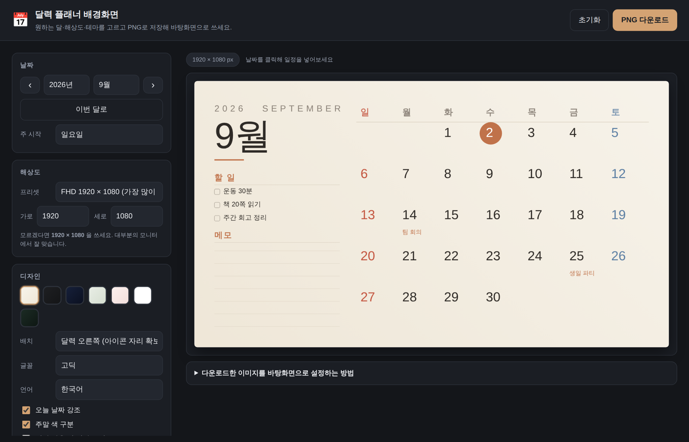

# 📅 달력 플래너 배경화면 만들기

원하는 달·해상도·테마를 골라 **컴퓨터 바탕화면으로 쓸 달력 플래너 이미지(PNG)** 를 만드는 도구입니다.
설치할 것도, 회원가입도, 인터넷 연결도 필요 없습니다. 파일을 내려받아 `index.html` 을 더블클릭하면 바로 열립니다.



## 사용법

1. 이 저장소를 내려받습니다.
   - GitHub 웹에서 **Code → Download ZIP** 을 누른 뒤 압축을 풀거나
   - `git clone https://github.com/psj49375020-cyber/test1.git`
2. 압축을 푼 폴더에서 **`index.html`** 을 더블클릭합니다. (Chrome, Edge, Safari, Firefox 모두 가능)
3. 왼쪽에서 달·해상도·테마·할 일 등을 설정합니다.
4. 오른쪽 위 **PNG 다운로드** 버튼을 누르면 이미지가 저장됩니다.
5. 저장한 이미지를 바탕화면으로 지정합니다. (아래 참고)

## 바탕화면으로 설정하기

| 환경 | 방법 |
| --- | --- |
| Windows 10 · 11 | 저장한 PNG 파일 우클릭 → **바탕 화면 배경으로 설정**. 또는 설정 → 개인 설정 → 배경 → 사진 찾아보기 (맞춤 방법: *채우기* 또는 *맞춤*) |
| macOS | Finder에서 파일 우클릭(Control-클릭) → **데스크탑 사진으로 설정**. 또는 시스템 설정 → 배경화면 → 사진 추가 |
| 아이폰 · 안드로이드 | 세로 해상도 프리셋으로 저장 → 사진 앱에서 배경화면으로 지정 |

> 글자가 흐릿하다면 **모니터 해상도와 같은 크기**로 다시 저장해 보세요. 해상도를 모르겠다면 `1920 × 1080` 이 무난합니다.

## 기능

- **달 이동** — 연도·월 선택, 좌우 화살표 키로도 이동
- **해상도 프리셋** — FHD / QHD / 4K / 노트북 / 맥북 / 울트라와이드 / 아이패드 / 스마트폰, 직접 입력도 가능
- **테마 7종** — 아이보리, 차콜, 미드나잇, 세이지, 블러쉬, 모노 화이트, 포레스트
- **배치 선택** — 달력을 오른쪽에 두어 왼쪽 **바탕화면 아이콘 자리를 비워둘 수 있습니다**
- **할 일 목록 · 메모 줄** — 제목과 항목을 직접 입력
- **날짜별 일정** — 미리보기에서 날짜를 클릭하면 바로 입력됩니다
- **배경 사진** — 내 사진을 깔고 덮기(어둡게) 정도를 조절
- **세부 옵션** — 주 시작 요일, 주말 색 구분, 오늘 강조, 이전·다음 달 날짜, 주별 가로선, 고딕/명조, 한국어/English, 하단 서명
- 설정은 브라우저에 자동 저장되어 다음에 열 때 그대로 이어집니다

## 개인정보

모든 작업은 **브라우저 안에서만** 이루어집니다. 입력한 일정·메모와 업로드한 사진은 어디로도 전송되지 않으며,
설정값은 사용 중인 브라우저의 로컬 저장소에만 남습니다. 지우려면 **초기화** 버튼을 누르세요.

## 폴더 구성

```
index.html          편집기 화면
assets/style.css    편집기 UI 스타일
assets/themes.js    색상 테마 정의
assets/renderer.js  캔버스에 달력을 그리는 렌더러
assets/app.js       설정 UI·저장·PNG 내보내기
docs/preview.png    미리보기 이미지
```

테마를 추가하고 싶다면 `assets/themes.js` 에 항목 하나를 복사해 색상만 바꾸면 됩니다. 화면의 테마 목록에 자동으로 나타납니다.

## 라이선스

MIT License — 자유롭게 사용·수정·배포할 수 있습니다.
